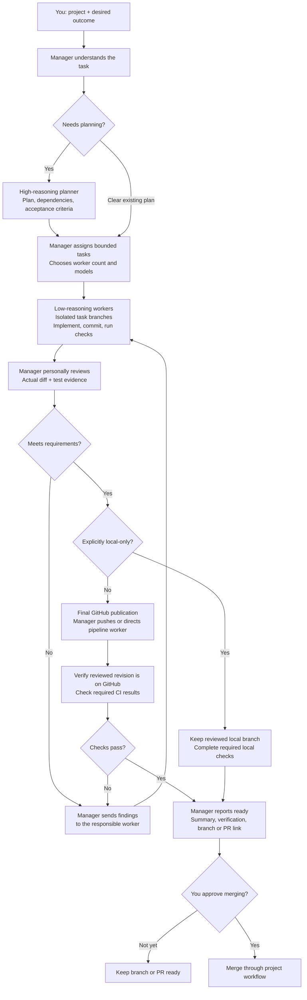

# Firstmate Swarm Config

A reusable settings preset for [Firstmate](https://github.com/kunchenguid/firstmate), using Herdr as the workspace and native coding CLIs as workers.

**High reasoning plans → a medium-reasoning manager assigns tasks → low-reasoning workers implement → the manager code reviews → workers fix findings → the manager re-reviews and accepts.**

This repository contains configuration and small launch helpers. Firstmate itself is downloaded separately from upstream and lives in an ignored `home/` directory. It is not vendored here.

## Where the agents run

Herdr provides the visible workspace. The manager is a Codex session following Firstmate's instructions; Firstmate launches and supervises the planner and worker sessions through their native CLIs. The same medium-reasoning manager coordinates assignments, personally reviews code, and owns final GitHub delivery.

## Workflow



The planner recommends useful parallel work; the manager adjusts concurrency to dependencies, edit conflicts, quota, machine resources, and review capacity. There is no fixed worker cap. Any code change after review must be reviewed again before final acceptance.

The graph shows final publication. A project's validation workflow may require an earlier worker push or PR; that preliminary publication is not manager acceptance. Explicit local-only tasks skip GitHub publication. Merge approval remains separate from task-branch push permission.

## What it configures

| Role | Default profiles | Responsibility |
| --- | --- | --- |
| Planner | Codex `gpt-6.1-sol` high; Claude `sonnet` high alternative | Resolve architecture and uncertainty; return a bounded plan. |
| Manager | Codex `gpt-6.1-sol` medium | Assign tasks, supervise workers, personally review actual diffs and verification, request fixes, and accept the result. |
| Workers | Codex `gpt-6-luna` low; Claude `haiku` low | Implement small, clear tasks and run relevant checks. |
| Extra review or escalation | Claude `sonnet` medium; Codex `gpt-6-luna` medium | Assist when needed; manager acceptance review still applies. |

Model identifiers are a snapshot of the original setup, not a guarantee of availability for your account. Edit `settings/config/crew-dispatch.json` and the manager model in `swarm` for models your CLI supports; keep `settings/captain.md` and `manager-start.md` consistent with those choices. Reasoning effort and model cost are separate choices.

- No fixed worker-count cap: the planner recommends the task split; the manager chooses concurrency based on dependencies, conflicting edits, current quota, machine resources, and supervision/review capacity. Planning and extra review workers count toward this assessment. The manager records the rationale in the task plan and adjusts concurrency as work changes.
- One manager; no nested swarms or native Codex subagents.
- Worker reports must identify the changes and checks actually run.
- The manager reads the actual diff, returns actionable findings to the worker, and reviews the updated changes before acceptance.
- Project validation and user authority over merging continue to apply.

Concurrency choices and the acceptance loop are standing agent instructions, not hard-coded enforcement. A full project assignment-to-acceptance cycle has not yet been exercised.

## Branches and publishing

Task-branch creation, scoped commits, and normal pushes to the identified project's configured GitHub remote are authorized as part of requested implementation; the manager does not need to ask again for those routine steps. Explicit local-only tasks stay local. Workers follow the project's normal delivery workflow, including pipeline-owned pushes and PRs.

The manager owns final publication after reviewing the code: it directs the owning worker when a pipeline owns the push, or performs an ordinary final task-branch push itself. It verifies the remote revision matches the reviewed code and required checks pass before reporting delivery ready. This permission does not authorize force pushes, branch deletion, remote/visibility changes, releases, deployments, or merging/pushing into the default branch. Default-branch delivery still requires explicit user authorization.

## Requirements

This preset targets Linux with Bash, Git, Python 3 (`python`), `flock`, and `readlink -f`.

Install Firstmate's prerequisites and these CLIs separately:

- `herdr`, `codex`, `claude`
- `quota-axi`, `treehouse`, `tasks-axi`
- `cursor-agent`, `opencode` (the current launcher's preflight requires these even while their automatic routes are disabled)

Authenticate the native CLIs you intend to use. No credentials, tokens, task history, project files, or running-session records are included. A subscription or login in one CLI does not create access or additional allowance in another.

The manager instructions use Codex's host-context approval mechanism for Firstmate's process and Herdr control commands. Normal sandbox and approval review remain enabled. Adapt this policy if your execution environment uses a different permission mechanism.

## Set up a fresh instance

```sh
git clone https://github.com/bobbyKhandar/firstmate-swarm-config.git
cd firstmate-swarm-config

git clone https://github.com/kunchenguid/firstmate.git home
git -C home checkout 42dd906d02f672652606057a193a6386b956c3f3
mkdir -p home/config home/data home/state
cp -a settings/config/. home/config/
cp settings/captain.md home/data/captain.md
chmod +x swarm bin/herdr-shell bin/enable-opencode.py

./swarm --check
./swarm
```

The source commit pins the Firstmate version used for this preset. Review upstream migration guidance before using a newer version. Use a fresh `home/`; do not overwrite a home with active work.

The launcher opens the persistent Herdr session `firstmate-tiered` and starts one manager. Run `./swarm` again to reconnect. If another instance uses that session name, choose a different name in `swarm` first. Tell the manager which repository to work on and the outcome you want; it begins with an empty task queue.

### Optional OpenCode route

OpenCode is excluded from automatic routing until its official browser login and a native low-variant probe succeed:

```sh
./swarm --connect-opencode
```

This uses the local OpenCode credential store. It does not copy credentials from Codex. The helper considers only its listed model candidates and leaves routing disabled if none passes. Account access and shared allowance still apply. After successful verification it updates the active `home/config/crew-dispatch.json`, not the committed template.

Cursor is excluded from automatic routing by default. Add a route only after verifying account access to a named model and the requested reasoning tier. Auto does not provide a pinned reasoning tier.

## Files and customization

| Path | Purpose |
| --- | --- |
| `settings/config/crew-dispatch.json` | Task-to-model routing rules. |
| `settings/captain.md` | Manager role, cost policy, and assignment/review loop. |
| `settings/config/brief-include.md` | Standing worker scope and handoff instructions. |
| `manager-start.md` | Manager startup instructions. |
| `swarm` | Workspace and medium-reasoning manager launcher. |
| `bin/herdr-shell` | Starts the manager in the initial workspace pane. |
| `bin/enable-opencode.py` | Optional OAuth check and live probe before enabling OpenCode. |
| `manifest.json` | Source version and hashes of distributed files. |

Settings are copied into `home/` during setup. Changes later made there are ignored by Git: copy intended, sanitized changes back into `settings/` before committing them. Review model and account claims for your machine before dispatching work.

Firstmate remains a separate upstream project with its own license and update process. This repository does not automatically update it or install dependencies.

## Verification

The preset passed shell/Python syntax checks, file-integrity checks, and a fresh-copy configuration smoke check with the installed dependencies. The original running manager acknowledged the review policy. These checks do not establish a complete project workflow or every account's access to the configured models.

## License

The configuration and launch helpers in this repository are available under the MIT license. Firstmate and the native CLI tools retain their own licenses.
