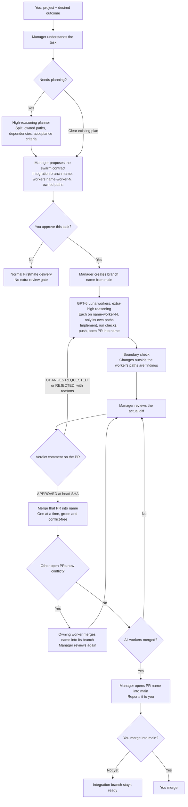

# Firstmate Swarm Config

A reusable settings preset for [Firstmate](https://github.com/kunchenguid/firstmate), using Herdr as the workspace and native coding CLIs as workers.

**High reasoning plans → a medium-reasoning manager splits the task into workers with exclusive file ownership → each GPT-6 Luna extra-high worker pushes its own branch and opens a PR → the manager approves, requests changes, or rejects on the PR → approved PRs merge one at a time into the task's integration branch → you merge that branch into `main` if you want it.**

This repository contains configuration and small launch helpers. Firstmate itself is downloaded separately from upstream and lives in an ignored `home/` directory. It is not vendored here.

## Where the agents run

Herdr provides the visible workspace. The manager is a Codex session following Firstmate's instructions; Firstmate launches and supervises the planner and worker sessions through their native CLIs. The same medium-reasoning manager coordinates assignments, personally reviews every worker PR, and merges approved work into the task's integration branch. It never edits or pushes project code itself.

## Workflow



A task is not a two-worker unit. The manager numbers workers `name-worker-1` through `name-worker-N`, and N is however many independent pieces the plan has. The planner recommends that split; the manager adjusts how many of those workers run at once based on dependencies, quota, machine resources, and review capacity. There is no fixed worker cap. Any code change after an approval needs a new review.

## What it configures

| Role | Default profiles | Responsibility |
| --- | --- | --- |
| Planner | Codex `gpt-6.1-sol` high; Claude `sonnet` high alternative | Resolve architecture and uncertainty; return a bounded plan. |
| Manager | Codex `gpt-6.1-sol` medium | Propose the per-task swarm contract, assign workers and their paths, review every worker PR, post verdicts, merge approved PRs into the integration branch, and open the final PR into `main`. |
| Workers | Codex `gpt-6-luna`, **extra-high** (`xhigh`) | Implement small, clear tasks and run relevant checks. |
| Extra review | Claude `sonnet` medium; Codex `gpt-6-luna` medium | An additional reviewer when you ask for one or the change justifies it; the manager's own review still applies. |
| Escalation | Codex `gpt-6.1-sol` **high**, then `gpt-6.1-sol` **extra-high** | When the manager rejects a worker's attempt, or the same finding survives two rounds of requested changes, the task is relaunched one step up, keeping its branch and PR. After the extra-high attempt, the manager reports to you instead of retrying. |

Model identifiers are a snapshot of the original setup, not a guarantee of availability for your account. Edit `settings/config/crew-dispatch.json` and the manager model in `swarm` for models your CLI supports; keep `settings/captain.md` and `manager-start.md` consistent with those choices. Reasoning effort and model cost are separate choices. The execution default is GPT-6 Luna xhigh for routine work too; quota pressure must not silently change the model or effort. This preset does not make a pricing or quota guarantee.

- No fixed worker-count cap: the planner recommends the task split; the manager chooses concurrency based on dependencies, conflicting edits, current quota, machine resources, and supervision/review capacity. Planning and extra review workers count toward this assessment. The manager records the rationale in the task plan and adjusts concurrency as work changes.
- One manager; no nested swarms or native Codex subagents.
- Worker reports must identify the changes and checks actually run.
- The manager reads the actual diff, posts its verdict on the PR, sends findings to the worker, and reviews every updated head before approving.
- Project validation applies, and merging into `main` stays with you.

Concurrency, ownership, and the review loop are agent instructions backed by `bin/swarm-branches` checks and Firstmate's merge guards, not by repository permissions. A full swarm task has not yet been run end to end; see the checklist under Verification.

## Branches, review, and merging

Firstmate only lets a current, explicit, concrete instruction from you relax its standing rules, so the manager's authority is granted per task. At intake it proposes a contract like this and waits for your go-ahead (a task message that already says this counts):

> Task `login` in `acme/app`: I create `login` from `main` and use as many workers as the split needs. This one has three: `login-worker-1` (owns `src/auth/`), `login-worker-2` (owns `src/ui/`), and `login-worker-3` (owns `src/api/`, after worker 1). Each pushes its own branch and opens a PR into `login`. I comment APPROVED, CHANGES REQUESTED, or REJECTED on each PR, merge approved PRs into `login` one at a time, then open a PR from `login` into `main` for you.

How workers stay out of each other's way:

- **Exclusive ownership.** Each worker owns a set of files or directories, recorded in the plan file (`home/data/swarm/<name>.json`). Every path has one owner, no matter how many workers the task has. A file several workers need goes to one owner, and the others depend on that worker and start after it merges.
- **Known boundaries.** Each worker's brief lists its own paths, the other workers' paths as read-only, its PR base, and its dependencies. A worker that needs a change outside its paths asks the manager instead of making it.
- **Mechanical checks.** `bin/swarm-branches check` rejects overlapping ownership and dependency cycles and prints the merge order. `boundary` flags any changed file outside a worker's paths, including files moved out of another worker's area. `overlap` lists files touched by more than one open worker branch.
- **One merge at a time.** Merges go through Firstmate's `bin/fm-pr-merge.sh`, which refuses unless the PR is mergeable, conflict-free, and green at its exact head. After each merge, a PR that now conflicts goes back to its worker, who merges the integration branch into its own branch (never a rebase or force-push), and the manager reviews it again.

All agents share your GitHub login, and GitHub does not let an account approve or request changes on its own pull request, so verdicts are PR comments (`Manager review: APPROVED at <sha>`) rather than formal reviews. For the same reason GitHub cannot tell the agents' merges from yours: a branch rule on `main` that requires a pull request stops direct pushes, but only a separate GitHub account for the swarm, plus a rule requiring your approval on `main`, enforces that only you merge into it.

The manager never edits, commits, or pushes project code. It creates the integration branch, comments, merges approved worker PRs into that branch, and opens the final PR. Force pushes, branch deletion, remote or visibility changes, releases, deployments, and anything into `main` are outside the contract. If you decline the contract, or the task must ship through Firstmate's `no-mistakes` pipeline, Firstmate delivers it the normal way without the extra review gate.

## Requirements

This preset targets Linux with Bash, Git, Python 3 (`python3`), `flock`, `jq`, and `readlink -f`.

Install Firstmate's prerequisites and these CLIs separately:

- `herdr`, `codex`, `claude`
- `quota-axi`, `treehouse`, `tasks-axi`
- `gh` and `gh-axi`, signed in to the GitHub account the swarm should use
- `cursor-agent` or `opencode` only if you add a route that uses them

`./swarm --check` names every missing command and setup step at once. It also checks that `home/` is at the pinned Firstmate commit; set `SWARM_ALLOW_UNPINNED=1` only after reviewing upstream's changes.

Authenticate the native CLIs you intend to use. No credentials, tokens, task history, project files, or running-session records are included. A subscription or login in one CLI does not create access or additional allowance in another.

The manager runs Firstmate's process and Herdr control commands through Codex's host-context escalation. Read [Security posture](#security-posture) for who approves those commands and how workers run.

## Security posture

Nothing in this preset runs workers in a sandbox. Know what each agent can do before pointing it at a real repository:

| Agent | How it runs | Who approves its commands |
| --- | --- | --- |
| Manager (Codex) | Codex workspace-write sandbox; Firstmate control scripts run in the host context through escalation | Default `SWARM_MANAGER_APPROVAL=auto`: Codex's automatic reviewer (`--approve-for-me`). `manual`: you, through your Codex approval policy. |
| Codex workers | Firstmate launches them with `--dangerously-bypass-approvals-and-sandbox` | Nobody; no sandbox |
| OpenCode workers (when enabled) | Firstmate launches them with every permission set to allow | Nobody |
| Claude workers | `--permission-mode auto`, set by this preset's `claude-permission-mode` | Claude Code's permission classifier |

Choose the manager mode when you start the workspace, for example `SWARM_MANAGER_APPROVAL=manual ./swarm`. The launcher records it in `home/state/` and prints it when the manager starts; it applies from the next manager launch.

Workers run unsandboxed in their own worktrees with your GitHub login, so this preset's limits on pushing and merging are instructions, not enforcement. Before using it on a real repository:

- Protect `main` on GitHub with a rule that requires a pull request, so nothing is pushed to it directly. Because the agents use your login, that rule does not stop them merging; run the swarm under a separate GitHub account and require your approval on `main` if you need that enforced.
- Prefer a GitHub credential limited to the repositories the swarm works on.
- Keep unrelated secrets out of the workers' environment; Firstmate's `config/launch-env-allowlist` limits what new workers inherit.

## Set up a fresh instance

```sh
git clone https://github.com/bobbyKhandar/firstmate-swarm-config.git
cd firstmate-swarm-config

git clone https://github.com/kunchenguid/firstmate.git home
git -C home checkout 42dd906d02f672652606057a193a6386b956c3f3
mkdir -p home/config home/data home/state
cp -a settings/config/. home/config/
cp settings/captain.md home/data/captain.md
chmod +x swarm bin/herdr-shell bin/*.py bin/swarm-branches

./swarm --check
./swarm
```

The source commit pins the Firstmate version used for this preset. Review upstream migration guidance before using a newer version. Use a fresh `home/`; do not overwrite a home with active work.

The launcher opens the persistent Herdr session `firstmate-tiered` and starts one manager. Run `./swarm` again to reconnect. If another instance uses that session name, choose a different name in `swarm` first. Tell the manager which repository to work on and the outcome you want; it begins with an empty task queue.

### Optional OpenCode route

OpenCode stays out of automatic routing with the pinned Firstmate. Its bootstrap reports any OpenCode profile that sets an effort as an invalid `crew-dispatch.json` (`crew_dispatch_validate` in `bin/fm-bootstrap.sh`), and a profile without an effort would not run at `xhigh`. Upstream `main` still behaves this way. `./swarm --connect-opencode` therefore refuses before starting any login.

Once you use a Firstmate version whose bootstrap accepts OpenCode efforts, enable it with:

```sh
SWARM_OPENCODE_FORCE=1 ./swarm --connect-opencode
```

This uses the local OpenCode credential store. It does not copy credentials from Codex. The helper considers only the exact `openai/gpt-6-luna` model, probes it at `xhigh` through the same agent `variant` setting Firstmate's worker launch uses, and leaves routing disabled if the probe fails. Account access and shared allowance still apply. After successful verification it adds the OpenCode profile next to every Codex `gpt-6-luna` `xhigh` profile in the active `home/config/crew-dispatch.json`, not the committed template.

Cursor is excluded from automatic routing by default. Add a route only after verifying account access to a named model and the requested reasoning tier. Auto does not provide a pinned reasoning tier.

## Files and customization

| Path | Purpose |
| --- | --- |
| `settings/config/crew-dispatch.json` | Task-to-model routing rules. |
| `settings/captain.md` | Manager role, cost policy, and assignment/review loop. |
| `settings/config/brief-include.md` | Standing worker scope and handoff instructions. |
| `manager-start.md` | Manager startup instructions. |
| `swarm` | Workspace and medium-reasoning manager launcher. |
| `bin/herdr-shell` | Starts the manager in the initial workspace pane. |
| `bin/enable-opencode.py` | Optional OAuth check and live probe before enabling OpenCode. |
| `manifest.json` | Source version and hashes of distributed files. |
| `bin/manifest.py` | Checks `manifest.json` against the tracked files, or regenerates it. |
| `bin/swarm-branches` | Creates and checks a task's plan file, checks worker boundaries and overlap, and creates the integration branch. |
| `bin/check-setup.py` | The configuration, pin, and route checks behind `./swarm --check`. |
| `tests/run.sh` | Fixture tests with stub CLIs; set `UPSTREAM_BOOTSTRAP` to a pinned `bin/fm-bootstrap.sh` to also run Firstmate's own dispatch validator. |
| `.github/workflows/ci.yml` | Runs ShellCheck, the Python compile check, the manifest check, and the fixture tests on every push. |

Settings are copied into `home/` during setup. Changes later made there are ignored by Git: copy intended, sanitized changes back into `settings/` before committing them. Review model and account claims for your machine before dispatching work.

After changing any tracked file, stage it and run `python3 bin/manifest.py update`, then commit `manifest.json` with the change. `python3 bin/manifest.py check` reports any file whose hash no longer matches.

Firstmate remains a separate upstream project with its own license and update process. This repository does not automatically update it or install dependencies.

## Verification

CI runs ShellCheck, a Python compile check, `python3 bin/manifest.py check`, and `bash tests/run.sh`, which exercises the launcher, `--check`, the manager approval switch, the OpenCode helper, and `bin/swarm-branches` against stub CLIs, and validates the dispatch file with the pinned Firstmate's own validator. Run the same tests locally with `bash tests/run.sh`. These checks do not establish a complete project workflow or every account's access to the configured models.

Before relying on the swarm workflow, run one small task that uses several workers, not a pair, in a test repository and confirm each step:

1. The manager proposes a swarm contract and waits for your go-ahead.
2. `home/data/swarm/<name>.json` exists and `bin/swarm-branches check` passes on it.
3. The integration branch appears on GitHub, created from `main`.
4. Each worker pushes `<name>-worker-N` and opens its PR into the integration branch, not `main`.
5. The manager posts a `Manager review:` verdict on each PR; a `CHANGES REQUESTED` round produces new commits and a new review.
6. Approved PRs merge one at a time into the integration branch, and a deliberately conflicting PR is sent back to its worker.
7. The manager opens a PR from the integration branch into `main`, reports it, and does not merge it.
8. Nothing was force-pushed, and nothing landed on `main` without you.

## License

The configuration and launch helpers in this repository are available under the MIT license. Firstmate and the native CLI tools retain their own licenses.
