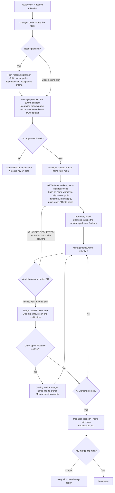

# Firstmate Swarm Config

A reusable settings preset for [Firstmate](https://github.com/kunchenguid/firstmate), using Herdr as the workspace and native coding CLIs as workers.

**High reasoning plans → a medium-reasoning manager splits the task into workers with exclusive file ownership → each GPT-6 Luna extra-high worker pushes its own branch and opens a PR → the manager approves, requests changes, or rejects on the PR → approved PRs merge one at a time into the task's integration branch → you merge that branch into `main` if you want it.**

This repository contains configuration and small launch helpers. Firstmate itself is downloaded separately from upstream and lives in an ignored `home/` directory. It is not vendored here.

## Where the agents run

Herdr provides the visible workspace. The manager is a Codex session following Firstmate's instructions; Firstmate launches and supervises the planner and worker sessions through their native CLIs. The same medium-reasoning manager coordinates assignments, personally reviews every worker PR, and merges approved work into the task's integration branch. It never edits or pushes project code itself.

## Workflow

A task is not a two-worker unit. The manager numbers workers `name-worker-1` through `name-worker-N`, and N is however many independent pieces the plan has. The planner recommends that split; the manager adjusts how many of those workers run at once based on dependencies, quota, machine resources, and review capacity. There is no fixed worker cap. Any code change after an approval needs a new review.
